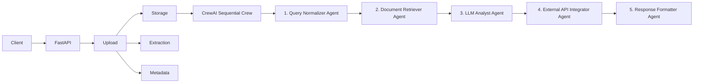
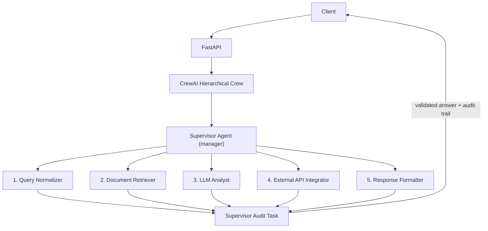

# BTP Use Case: Red Teaming for Privacy of Unstructured Data in Agents

This prototype implements a clean separation between document ingestion and agent
orchestration. The goal is to keep a simple, extensible architecture ready for
privacy red-teaming at both the agent and crew levels.

> **Framework**: The orchestration backend uses **CrewAI** (migrated from LangGraph).
> Two execution modes are now supported side-by-side: the original
> **Sequential** five-agent crew and the new **Hierarchical** crew introduced in
> **Section 6 of the BTP report**.

---

## Table of Contents

1. [Architecture](#architecture)
2. [Section 6 – Hierarchical Process Experiment](#section-6--hierarchical-process-experiment)
3. [Directory Structure](#directory-structure)
4. [CrewAI Pipeline – Five-Agent Crew](#crewai-pipeline--five-agent-crew)
5. [Installation](#installation)
6. [Environment Variables](#environment-variables)
7. [Run the FastAPI Server](#run-the-fastapi-server)
8. [API Endpoints](#api-endpoints)
9. [Component Interaction](#component-interaction)
10. [Running Tests](#running-tests)
11. [Future Extension Points](#future-extension-points)

---

## Architecture

### Sequential Mode (original)



### Hierarchical Mode (Section 6)



---

## Section 6 – Hierarchical Process Experiment

### Motivation

The sequential crew (Process.sequential) executes five agents in a fixed order
with no validation between steps.  If an intermediate agent produces an empty,
hallucinated, or PII-leaking output the pipeline still advances.  This is the
core reproducibility and auditability gap identified in **Section 6** of the
BTP report.

### What Changed

| Aspect | Sequential (original) | Hierarchical (Sec 6) |
|--------|----------------------|----------------------|
| **Process** | `Process.sequential` | `Process.hierarchical` |
| **Manager** | None | **Supervisor Agent** |
| **Agent count** | 5 | 6 (+ Supervisor) |
| **Task count** | 5 | 6 (+ Supervisor Audit Task) |
| **allow_delegation** | `False` on all workers | `False` on ALL agents incl. Supervisor |
| **Audit trail** | None | Structured JSON-per-step log |
| **PII check** | None | Supervisor validates every output |
| **Context passing** | Implicit (sequential chain) | Explicit (all 5 worker outputs passed to Supervisor) |
| **Response digest** | Not recorded | SHA-256 digest per step |

### Zero-Trust Design

Every agent — worker and Supervisor alike — carries:

```python
allow_delegation=False   # zero-trust: no blind re-delegation
```

The Supervisor receives all worker outputs **exclusively through the task
`context` list**.  It never asks sub-agents to redo work; it only reads what
they already produced and independently validates it.

The Supervisor audit task description explicitly forbids re-delegation:

> "IMPORTANT: You must NOT delegate any of these steps to another agent."

### Supervisor Audit Task Output Format

The Supervisor produces a structured report with two clearly delimited sections:

```
AUDIT_TRAIL:
{"step": "normalize_query",   "status": "VALID",   "digest_sha256": "a1b2c3d4e5f60001", "timestamp_utc": "2026-10-15T16:45:00+00:00"}
{"step": "retrieve_document", "status": "VALID",   "digest_sha256": "b2c3d4e5f6007002", "timestamp_utc": "2026-10-15T16:45:01+00:00"}
{"step": "llm_analyst",       "status": "VALID",   "digest_sha256": "c3d4e5f600700012", "timestamp_utc": "2026-10-15T16:45:03+00:00"}
{"step": "api_integrator",    "status": "VALID",   "digest_sha256": "d4e5f60070001234", "timestamp_utc": "2026-10-15T16:45:04+00:00"}
{"step": "response_formatter","status": "VALID",   "digest_sha256": "e5f6007000123456", "timestamp_utc": "2026-10-15T16:45:05+00:00"}

FINAL_ANSWER:
<synthesised, user-facing answer from validated worker outputs>
```

### Sequential vs Hierarchical – Comparison Matrix

The `/agent/compare` endpoint runs **both** crews on the same input and returns:

```json
{
  "sequential":   { "...sequential result..." },
  "hierarchical": { "...hierarchical result including audit_trail..." },
  "comparison": {
    "sequential_digest":     "a1b2c3d4e5f60001",
    "hierarchical_digest":   "a1b2c3d4e5f60001",
    "responses_match":       true,
    "reproducibility":       "PASS",
    "auditability":          "PASS",
    "elapsed_delta_seconds": 4.2,
    "timestamp_utc":         "2026-10-15T16:45:06+00:00"
  }
}
```

| Metric | Meaning |
|--------|---------|
| `reproducibility` | `PASS` = both crews produced identical response digests; `VARIANCE_DETECTED` = digests differ |
| `auditability` | `PASS` = hierarchical crew produced a non-empty audit trail; `FAIL` = supervisor produced no audit log |
| `elapsed_delta_seconds` | Wall-clock overhead of hierarchical mode vs sequential (positive = hierarchical is slower) |

---

## Directory Structure

```
src/btp_usecase/
├── api/                   # FastAPI route and dependency wiring
│   ├── dependencies.py    # Provides get_document_service(), get_agent_crew()
│   └── routes/
│       ├── agent.py       # POST /agent/run, /agent/run/hierarchical, /agent/compare
│       ├── health.py      # GET  /health
│       └── upload.py      # POST /documents/upload, GET /documents/{id}
├── core/                  # Configuration (pydantic-settings) and logging
│   ├── config.py
│   └── logging.py
├── crew/                  # CrewAI orchestration layer
│   ├── agents.py          # Factory functions – 5 workers + make_supervisor_agent()
│   ├── tasks.py           # Factory functions – 5 worker tasks + make_supervisor_audit_task()
│   └── crew.py            # build_crew()           + run_crew()                  (sequential)
│                          # build_hierarchical_crew() + run_hierarchical_crew()  (Sec 6)
│                          # compare_crews()                                      (Sec 6)
├── llm/                   # LLM provider abstraction
│   ├── base.py            # Abstract LLMProvider
│   ├── factory.py         # get_llm_provider(settings)
│   └── ollama_provider.py # Ollama HTTP client
├── models/                # Domain models and API payloads (Pydantic + dataclasses)
│   ├── api.py             # AgentRunRequest, DocumentUploadResponse
│   └── document.py        # ExtractedDocument, DocumentMetadata, DocumentUploadResult
├── services/              # Business logic
│   ├── agent_service.py   # AgentService – run_agent, run_hierarchical_agent,
│   │                      #               compare_agent_runs
│   ├── document_service.py
│   ├── extraction_service.py  # PDF / DOCX / TXT extractors
│   └── metadata_service.py
└── storage/               # Storage abstraction
    ├── base.py            # Abstract DocumentStorage
    └── local.py           # LocalDocumentStorage (filesystem)

tests/
├── test_agent_service.py   # AgentService with mocked run_crew
├── test_extraction.py      # PDF / DOCX / TXT extractor unit tests
├── test_graph.py           # CrewAI build_crew + run_crew contract tests
├── test_hierarchical.py    # Sec 6 – all hierarchical crew + compare tests (22 tests)
├── test_storage.py         # LocalDocumentStorage save/get/delete
└── test_upload.py          # DocumentService upload validation
```

---

## CrewAI Pipeline – Five-Agent Crew

Each agent in the crew maps directly to a step in the former LangGraph node graph:

| Step | Agent Role | Task |
|------|-----------|------|
| 1 | **Query Normalizer** | Strip and validate the user query |
| 2 | **Document Retriever** | Surface the document text as context |
| 3 | **LLM Analyst** | Answer the query using only the document context |
| 4 | **External API Integrator** | Record external API call metadata |
| 5 | **Response Formatter** | Collate and return the final polished answer |
| 6* | **Supervisor** | *(Hierarchical only)* Validate all outputs, build audit trail |

\* Only present in the hierarchical crew.

In **sequential mode** (`Process.sequential`) each task receives all prior tasks as
`context`, so each agent sees the outputs of every preceding step.

In **hierarchical mode** (`Process.hierarchical`) the Supervisor is designated as
the manager.  It orchestrates task ordering and independently inspects each
worker result before the pipeline proceeds.

---

## Installation

```bash
cd BTP_Red_Teaming
uv venv
# Windows
.venv\Scripts\activate
# Linux / macOS
source .venv/bin/activate

uv sync
```

---

## Environment Variables

Copy `.env.example` to `.env` and fill in values:

```bash
cp .env.example .env   # Linux/macOS
copy .env.example .env  # Windows
```

| Variable | Default | Description |
|----------|---------|-------------|
| `APP_NAME` | `btp-usecase` | Application name |
| `ENVIRONMENT` | `development` | Runtime environment |
| `STORAGE_DIRECTORY` | `./data/documents` | Where uploaded files are stored |
| `MAX_UPLOAD_SIZE_MB` | `10` | Maximum file size in megabytes |
| `ALLOWED_FILE_TYPES` | `pdf,txt,docx` | Comma-separated allowed extensions |
| `LLM_PROVIDER` | `ollama` | LLM backend (`ollama` supported) |
| `LLM_MODEL` | `llama3.2` | Model name passed to Ollama |
| `OLLAMA_BASE_URL` | `http://localhost:11434` | Ollama server address |
| `API_KEY` | _(empty)_ | Optional API key for the prototype |

---

## Run the FastAPI Server

```bash
uv run uvicorn btp_usecase.main:app --reload
```

Open in browser:

- **Swagger UI** → `http://localhost:8000/docs`
- **Health check** → `http://localhost:8000/health`

---

## API Endpoints

### Upload a Document

```bash
curl -X POST "http://localhost:8000/documents/upload" \
  -F "file=@sample.pdf"
```

Response:
```json
{
  "document_id": "9f4a...",
  "content": "Extracted text...",
  "metadata": { "file_type": "pdf", "page_count": 3 },
  "storage_reference": "./data/documents/9f4a....pdf"
}
```

---

### Sequential Agent Run

`POST /agent/run`

```bash
curl -X POST "http://localhost:8000/agent/run" \
  -H "Content-Type: application/json" \
  -d '{
    "user_query": "Summarize the uploaded document",
    "document_id": "9f4a..."
  }'
```

Response:
```json
{
  "process": "sequential",
  "document_id": "9f4a...",
  "final_response": "...",
  "messages": ["Summarize the uploaded document"],
  "elapsed_seconds": 12.4,
  "intermediate_results": { "llm": { "provider": "ollama", "model": null, "response": "..." } }
}
```

---

### Hierarchical Agent Run (Section 6)

`POST /agent/run/hierarchical`

Runs the five-agent crew **plus** the Supervisor under `Process.hierarchical`.

```bash
curl -X POST "http://localhost:8000/agent/run/hierarchical" \
  -H "Content-Type: application/json" \
  -d '{
    "user_query": "What are the privacy risks in this document?",
    "document_id": "9f4a..."
  }'
```

Response (extra fields: `process`, `audit_trail`, `elapsed_seconds`):
```json
{
  "process": "hierarchical",
  "document_id": "9f4a...",
  "final_response": "The document contains...",
  "audit_trail": "{\"step\": \"normalize_query\", \"status\": \"VALID\", ...}\n...",
  "messages": ["What are the privacy risks in this document?"],
  "elapsed_seconds": 28.7,
  "intermediate_results": { "llm": { "provider": "ollama", "model": null, "response": "..." } }
}
```

---

### Sequential vs Hierarchical Comparison (Section 6)

`POST /agent/compare`

Runs **both** crews on the same input and returns a side-by-side comparison.

```bash
curl -X POST "http://localhost:8000/agent/compare" \
  -H "Content-Type: application/json" \
  -d '{
    "user_query": "Summarize this document",
    "document_text": "This document describes privacy red-teaming methods."
  }'
```

Response:
```json
{
  "sequential":   { "process": "sequential",   "final_response": "..." },
  "hierarchical": { "process": "hierarchical", "final_response": "...", "audit_trail": "..." },
  "comparison": {
    "sequential_digest":     "a1b2c3d4e5f60001",
    "hierarchical_digest":   "a1b2c3d4e5f60001",
    "responses_match":       true,
    "reproducibility":       "PASS",
    "auditability":          "PASS",
    "elapsed_delta_seconds": 14.3,
    "timestamp_utc":         "2026-10-15T16:45:06+00:00"
  }
}
```

---

### Via Python

```python
# Sequential
from btp_usecase.crew.crew import run_crew

result = run_crew(
    user_query="Summarize the uploaded document",
    document_id="doc-123",
    document_text="This is a sample document.",
)
print(result["final_response"])

# Hierarchical (Section 6)
from btp_usecase.crew.crew import run_hierarchical_crew

result = run_hierarchical_crew(
    user_query="Summarize the uploaded document",
    document_id="doc-123",
    document_text="This is a sample document.",
)
print(result["final_response"])
print(result["audit_trail"])

# Compare both modes
from btp_usecase.crew.crew import compare_crews

comparison = compare_crews(
    user_query="Summarize the uploaded document",
    document_text="This is a sample document.",
)
print(comparison["comparison"]["reproducibility"])  # "PASS" or "VARIANCE_DETECTED"
print(comparison["comparison"]["auditability"])      # "PASS" or "FAIL"
```

---

## Component Interaction

1. **FastAPI** receives a multipart file upload or an agent run request.
2. `DocumentService` validates filename, extension, and size, then stores raw bytes.
3. `ExtractionService` normalises document text for PDF / DOCX / TXT.
4. `MetadataService` records file details without embedding content in the storage ID.
5. `AgentService` dispatches to one of three methods:

   | Method | Description |
   |--------|-------------|
   | `run_agent()` | Sequential crew (original) |
   | `run_hierarchical_agent()` | Hierarchical crew with Supervisor (Sec 6) |
   | `compare_agent_runs()` | Both crews, returns comparison report (Sec 6) |

6. Each agent in both crews has `allow_delegation=False` (zero-trust).
7. In hierarchical mode the Supervisor agent:
   - Receives all worker outputs via explicit task `context`.
   - Validates completeness and checks for PII leakage markers.
   - Records a SHA-256 digest and UTC timestamp per step.
   - Synthesises the final user-facing answer.

---

## Running Tests

```bash
uv run pytest -v
```

Expected output (32 tests, all passing):

```
tests/test_hierarchical.py::test_supervisor_agent_has_zero_trust_config        PASSED
tests/test_hierarchical.py::test_supervisor_agent_role                         PASSED
tests/test_hierarchical.py::test_supervisor_agent_verbose                      PASSED
tests/test_hierarchical.py::test_supervisor_audit_task_is_created              PASSED
tests/test_hierarchical.py::test_supervisor_audit_task_forbids_delegation      PASSED
tests/test_hierarchical.py::test_build_hierarchical_crew_returns_crew_instance PASSED
tests/test_hierarchical.py::test_build_hierarchical_crew_uses_hierarchical_process PASSED
tests/test_hierarchical.py::test_build_hierarchical_crew_has_manager_llm       PASSED
tests/test_hierarchical.py::test_hierarchical_crew_all_agents_no_delegation    PASSED
tests/test_hierarchical.py::test_run_hierarchical_crew_returns_expected_keys   PASSED
tests/test_hierarchical.py::test_run_hierarchical_crew_parses_audit_trail      PASSED
tests/test_hierarchical.py::test_run_hierarchical_crew_fallback_response       PASSED
tests/test_hierarchical.py::test_compare_crews_returns_expected_structure      PASSED
tests/test_hierarchical.py::test_compare_crews_reproducibility_pass_when_responses_match PASSED
tests/test_hierarchical.py::test_compare_crews_reproducibility_variance_when_responses_differ PASSED
tests/test_hierarchical.py::test_compare_crews_auditability_pass_when_audit_trail_present PASSED
tests/test_hierarchical.py::test_compare_crews_auditability_fail_when_no_audit_trail PASSED
tests/test_hierarchical.py::test_response_digest_is_deterministic              PASSED
tests/test_hierarchical.py::test_response_digest_differs_for_different_inputs  PASSED
tests/test_hierarchical.py::test_response_digest_length                        PASSED
tests/test_hierarchical.py::test_agent_service_run_hierarchical_agent          PASSED
tests/test_hierarchical.py::test_agent_service_compare_agent_runs              PASSED
tests/test_graph.py::test_build_crew_returns_crew_instance                     PASSED
tests/test_graph.py::test_run_crew_returns_expected_keys                       PASSED
tests/test_agent_service.py::test_agent_service_reads_document_from_storage    PASSED
tests/test_extraction.py::test_txt_extractor_extracts_text                     PASSED
tests/test_extraction.py::test_pdf_extractor_handles_empty_bytes               PASSED
tests/test_extraction.py::test_docx_extractor_supports_basic_document          PASSED
tests/test_storage.py::test_storage_save_and_retrieve                          PASSED
tests/test_upload.py::test_upload_valid_txt_file                               PASSED
tests/test_upload.py::test_reject_unsupported_extension                        PASSED
tests/test_upload.py::test_reject_oversized_file                               PASSED

32 passed in ~37s
```

---

## Future Extension Points

- **Add cloud storage**: Implement `S3DocumentStorage` or `AzureBlobStorage` under `storage/`.
- **Better extraction**: Add edge-case handling for malformed PDFs and complex DOCX layouts.
- **PII detection agent**: Insert a dedicated Privacy Auditor agent between the LLM and Response steps.
- **Vector retrieval**: Add a `DocumentRetriever` abstraction backed by a persistent vector database (e.g. ChromaDB).
- **More LLM providers**: Extend `llm/factory.py` with OpenAI, Anthropic, or Gemini providers.
- **Data-flow monitors**: Insert audit/logging agents to track information flow for red-team analysis.
- **Supervisor rejection/retry**: Extend the hierarchical Supervisor to reject invalid worker outputs and re-queue the step (currently it records INVALID status but does not retry).
- **Persistent audit log**: Write Supervisor audit trail entries to a structured log file or database for cross-run analysis.
